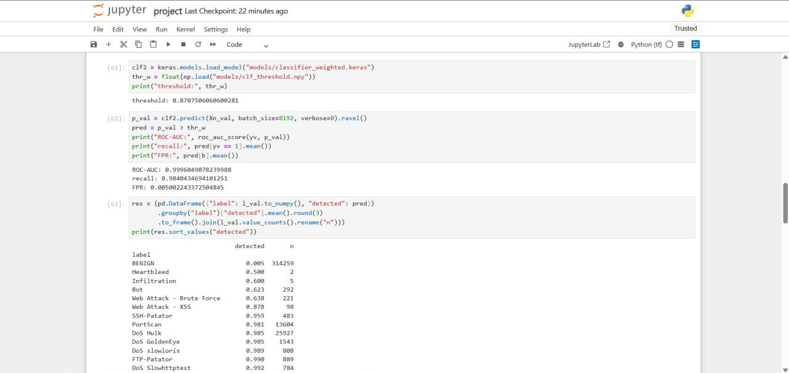
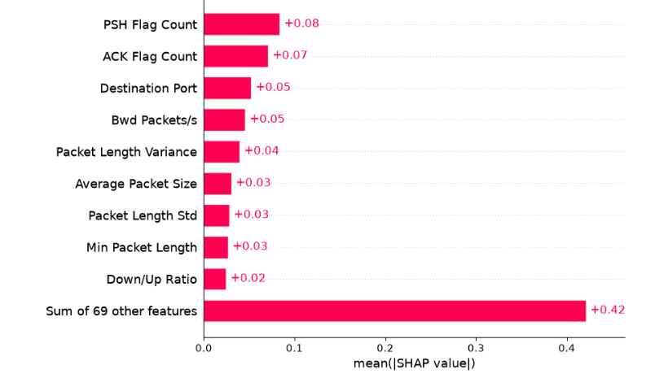
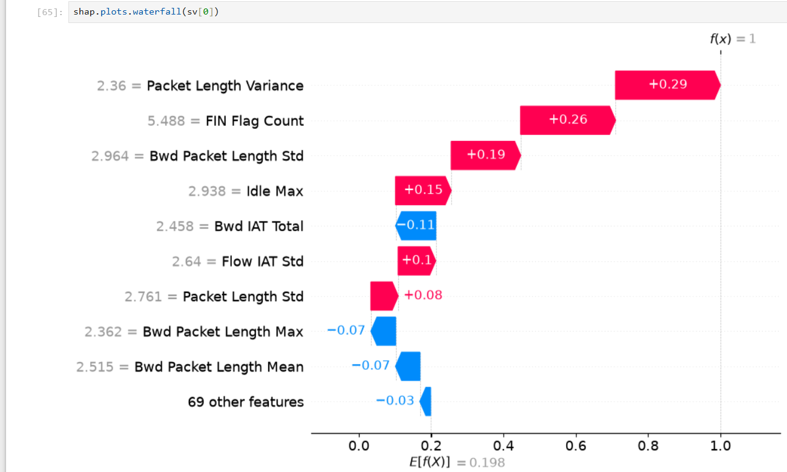
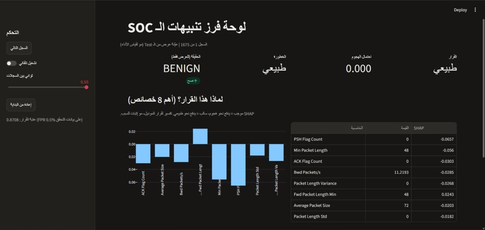
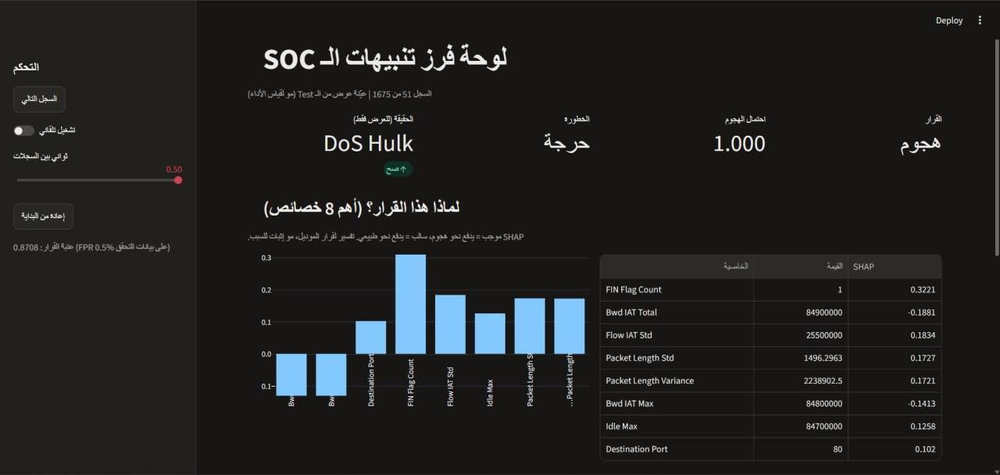
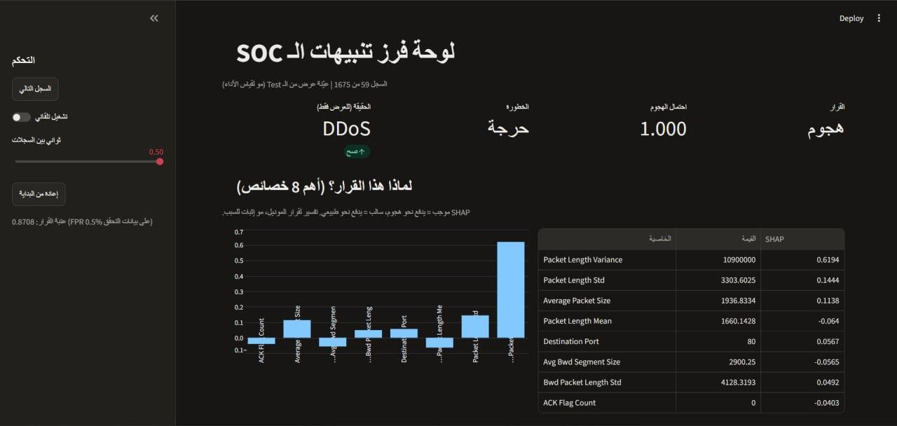

<div dir="rtl">

# فرز تنبيهات الـ SOC بشبكة عصبية عميقة (MLP) على CICIDS2017

نظام تعلم عميق يصنّف سجلات حركة الشبكة إلى **طبيعي** أو **هجوم**، لمساعدة محلل مركز العمليات الأمنية (SOC) على فرز التنبيهات. مبني بـ `TensorFlow/Keras`، مع تفسير القرارات بـ `SHAP`، وواجهة `Streamlit` تعيد تشغيل السجلات وتشرح كل قرار.

> **ملاحظة صدق:** كل الأرقام هنا على مجموعة بيانات واحدة (`CICIDS2017`). لم يُختبر التعميم على بيانات أخرى، ولا يدّعي المشروع كشف الهجمات غير المعروفة.

---

## النتيجة بسرعة

| المقياس | التحقق (Validation) | الاختبار (Test) |
|---|---|---|
| ROC-AUC | 0.99960 | 0.99962 |
| Recall (نسبة الكشف) | 98.40% | **98.42%** |
| FPR (معدل الإنذار الكاذب) | 0.50% | **0.47%** |

- الموديل: MLP بطبقتين مخفيتين (128 ثم 64)، إجمالي 18,433 معاملًا.
- عتبة القرار: **0.8707506**، مختارة من بيانات التحقق عند FPR = 0.5%.
- قيم الاختبار قريبة جدًا من التحقق، فالعتبة لم تُضبط بإفراط. وقيم الاختبار حُسبت بتقييم واحد.

---

## المشكلة

يستقبل محللو الـ SOC آلاف التنبيهات يوميًا، وكثير منها إنذارات كاذبة تستهلك وقتهم. المطلوب فرز آلي يكشف أغلب الهجمات **ويبقي الإنذارات الكاذبة قليلة**، ويشرح سبب كل قرار حتى يثق به المحلل.

## الداتاسيت

- **CICIDS2017** (المعهد الكندي للأمن السيبراني، جامعة نيو برنزويك)، نسخة `MachineLearningCSV` (8 ملفات CSV).
- المصدر الرسمي: https://www.unb.ca/cic/datasets/ids-2017.html
- حُمّلت من مرآة غير رسمية على Hugging Face: `bencorn/CICIDS2017`.
- الحجم الخام: 2,830,743 سجلًا × 79 عمودًا.

**التنظيف:** إزالة المسافات من أسماء الأعمدة، إصلاح الرموز التالفة في أسماء الهجمات، حذف القيم اللانهائية والمفقودة، حذف المكرر. النتيجة: **2,520,798 سجلًا و78 خاصية**، منها 2,095,057 طبيعيًا (83.1%) و425,741 هجومًا (16.9%).

**التقسيم:** تدريب 70% / تحقق 15% / اختبار 15%، موزّع حسب نوع الهجوم (`stratify`)، بذرة `random_state=42`، قبل أي تطبيع حتى لا تتسرب معلومات.

| المجموعة | الحجم |
|---|---|
| Train | 1,764,558 × 78 |
| Validation | 378,120 × 78 |
| Test | 378,120 × 78 |

## المنهجية

1. **التطبيع:** طبقة `Normalization` في Keras تتعلم من التدريب فقط، ثم قصّ القيم بين -10 و 10 (بعض الخصائص مثل `Flow Bytes/s` فيها قيم ضخمة).
2. **المعمارية:**

| الطبقة | الحجم |
|---|---|
| Input | 78 |
| Dense + ReLU | 128 |
| Dropout | 0.2 |
| Dense + ReLU | 64 |
| Dropout | 0.2 |
| Dense + Sigmoid | 1 |

3. **التدريب:** `Adam` بمعدل 0.001، خسارة `binary crossentropy`، دفعة 2048، حتى 15 دورة مع `EarlyStopping` على AUC التحقق (`patience=3`).
4. **أوزان العيّنات حسب نوع الهجوم:** الوزن = الجذر التربيعي لنسبة (أكبر عدد أمثلة لنوع / عدد أمثلة النوع)، مقصوص بين 1 و 30.
   - السبب: النموذج بدون أوزان ضعف على أنواع قليلة العدد رغم أنه تدرّب عليها: Web Brute Force حوالي 7%، XSS حوالي 2%، Bot حوالي 36%، لأن الحركة الطبيعية تطغى.
5. **اختيار العتبة:** الأوزان رفعت الكشف لكن عند العتبة 0.5 ارتفعت الإنذارات الكاذبة إلى 2.2% (حوالي 7 أضعاف). فاخترنا العتبة من التحقق عند FPR مستهدف:

| FPR المستهدف | العتبة | Recall |
|---|---|---|
| 0.2% | 0.9152 | 96.26% |
| **0.5% (المعتمد)** | **0.8708** | **98.40%** |
| 1.0% | 0.7225 | 99.44% |

## الكشف حسب نوع الهجوم (Validation، العتبة المعتمدة)

| النوع | العدد | نسبة الكشف |
|---|---|---|
| DoS Hulk | 25,927 | 98.5% |
| DDoS | 19,202 | 99.5% |
| PortScan | 13,604 | 98.1% |
| DoS GoldenEye | 1,543 | 98.5% |
| FTP-Patator | 889 | 99.0% |
| DoS slowloris | 808 | 98.9% |
| DoS Slowhttptest | 784 | 99.2% |
| SSH-Patator | 483 | 95.9% |
| Bot | 292 | 62.3% |
| Web Attack - Brute Force | 221 | 63.8% |
| Web Attack - XSS | 98 | 87.8% |
| Infiltration * | 5 | 60.0% |
| Web Attack - Sql Injection * | 3 | 100% |
| Heartbleed * | 2 | 50.0% |
| **BENIGN (معدل الإنذار الكاذب)** | 314,259 | **0.5%** |

\* أنواع بعدد سجلات صغير جدًا، لا يصح الاستنتاج منها.

أضعف الأنواع: `Bot` و`Web Attack - Brute Force` و`XSS`. عند العتبة 0.5 كان كشف Brute Force وXSS حوالي 99%، لكن بإنذارات كاذبة 2.2%، فاختيار العتبة مقايضة بين الكشف والإنذارات.



## التفسير بـ SHAP

استُخدم `PermutationExplainer` على مخرجات الشبكة، مع 100 سجل خلفية و100 سجل للتفسير (بذرة 42).

**الأهمية العامة:** أعلام TCP (`PSH Flag Count` و`ACK Flag Count`) ومنفذ الوجهة (`Destination Port`) ومعدلات الحزم وأطوالها. لا توجد خاصية واحدة مسيطرة: مجموع أثر أهم 9 خصائص نحو 0.40، ومجموع الـ 69 الباقية نحو 0.42.



**تفسير سجل واحد (Waterfall):**



> SHAP يفسّر قرار النموذج، ولا يثبت أن الخاصية هي السبب الحقيقي للهجوم. وظهور `Destination Port` ضمن الأهم قد يعني أن النموذج يربط بعض المنافذ بالهجمات.

## الواجهة (Streamlit)

تعيد تشغيل عيّنة من سجلات الاختبار (1,675 سجلًا) سجلًا بعد سجل، يدويًا أو تلقائيًا، وتعرض لكل سجل: القرار، احتمال الهجوم، مستوى الخطورة، النوع الحقيقي (للعرض فقط)، وأهم 8 خصائص مؤثرة بـ SHAP، مع سجل بآخر 10 تنبيهات.

| سجل طبيعي | هجوم DoS Hulk | هجوم DDoS |
|---|---|---|
|  |  |  |

> مستويات الخطورة (متوسطة / عالية / حرجة) للعرض التوضيحي فقط ولم يُتحقق من حدودها. والقرار الفعلي هو: الاحتمال أكبر من العتبة 0.8708. وعيّنة العرض فيها أنواع نادرة بكثرة، فلا تُستخدم لقياس الأداء.

---

## التشغيل

### 1) البيئة (الإصدارات المستخدمة)

```bash
conda create -n tf python=3.11
conda activate tf
pip install tensorflow==2.21.0 scikit-learn==1.9.1 shap==0.51.0 streamlit==1.67.0
pip install pandas numpy pyarrow huggingface_hub jupyterlab
```

التدريب جرى على المعالج (CPU)، ولا يحتاج كرت شاشة.

### 2) الداتاسيت

الداتاسيت **غير مرفق** (حجمه كبير). حمّله من الرابط الرسمي أو من المرآة:

```python
from huggingface_hub import list_repo_files, hf_hub_download
import zipfile

repo = "bencorn/CICIDS2017"
files = [f for f in list_repo_files(repo, repo_type="dataset") if "MachineLearningCSV" in f]
path = hf_hub_download(repo, files[0], repo_type="dataset", local_dir="data")
with zipfile.ZipFile(path) as z:
    z.extractall("data")
```

### 3) الدفتر

افتح `project.ipynb` وشغّل الخلايا بالترتيب: الاستيراد، القراءة والتنظيف، التقسيم، التطبيع، تعريف الشبكة، ثم تحميل النموذج المحفوظ وتقييمه، ثم SHAP.

- خلية التدريب الموزون موجودة للتوثيق. **النموذج المحفوظ هو الذي أعطى الأرقام أعلاه**، وإعادة التدريب تعطي أرقامًا قريبة لكن غير مطابقة تمامًا.
- لتوليد عيّنة الواجهة (`data/test_sample.parquet`) شغّل خلية العيّنة في الدفتر.

### 4) الواجهة

من مجلد المشروع:

```bash
streamlit run app/dashboard.py
```

## هيكل المشروع

```
.
├── project.ipynb                  # الدفتر (التنظيف، التقسيم، النموذج، التقييم، SHAP)
├── app/
│   └── dashboard.py               # واجهة Streamlit
├── models/
│   ├── classifier_weighted.keras  # النموذج النهائي
│   ├── clf_threshold.npy          # العتبة 0.8707506
│   ├── norm_mean.npy              # متوسط التطبيع (من التدريب)
│   ├── norm_var.npy               # تباين التطبيع (من التدريب)
│   ├── features.csv               # أسماء الخصائص بالترتيب
│   └── shap_background.npy        # خلفية SHAP (100 سجل)
├── data/                          # غير مرفق (الداتاسيت + clean.parquet + test_sample.parquet)
└── images/                        # لقطات الشاشة
```

## الإعادة والعشوائية

- التقسيم بذرته `42`، وعيّنة SHAP بذرتها `42`.
- التدريب فيه عشوائية (الأوزان الابتدائية، Dropout، ترتيب الدفعات)، وأرقام النتائج هنا من **نموذج محفوظ واحد** وعتبة ثابتة، فالتقييم نفسه يتكرر بنفس النتيجة.
- قيم SHAP الدقيقة قد تتغير شوي بين التشغيلات (طريقة Permutation)، بينما يبقى الاتجاه.

## القيود

- **مجموعة بيانات واحدة:** التقسيم عشوائي، فتوجد سجلات متشابهة من نفس الهجوم في التدريب والاختبار، وقد تكون الأرقام متفائلة.
- **أنواع قليلة العدد:** Infiltration وSQL Injection وHeartbleed (5 و3 و2 سجلات في التحقق) لا يصح الاستنتاج منها. وأرقام Bot وWeb Attack تقريبية.
- **لا كشف للهجمات غير المعروفة:** النظام مدرّب على أنواع معروفة ولم يُختبر على هجمات جديدة.
- **الاعتماد على `Destination Port`:** قد يحفظ النموذج الخدمات بدل سلوك الهجوم، ولم يُختبر أثر إزالتها.
- **التفسير:** SHAP يفسّر النموذج ولا يثبت السبب، وحُسب على عيّنة صغيرة.
- **الواجهة:** تعيد تشغيل سجلات مسجلة وليست متصلة بحركة شبكة حية.
- **نماذج أخرى:** جُرّبت نماذج أخرى أثناء التطوير ولم تدخل في النظام النهائي، واستُخدمت مجموعة الاختبار لتقييم واحد لكل نموذج دون تعديل عتبات أو إعدادات بعده.

## العمل المستقبلي

- اختبار متقاطع: التدريب على `CICIDS2017` والاختبار على `UNSW-NB15` بعد توحيد الخصائص المشتركة.
- تكرار التدريب ببذور عشوائية متعددة وتقرير المتوسط والانحراف، وتقسيم حسب الزمن.
- اختبار إزالة `Destination Port`.
- تحسين كشف `Bot` و`Web Attack` (أوزان أو عتبات خاصة بكل نوع).
- تصنيف متعدد الفئات وربط الواجهة ببيانات حية.

## المراجع

1. Sharafaldin, I., Lashkari, A. H., & Ghorbani, A. A. (2018). *Toward generating a new intrusion detection dataset and intrusion traffic characterization.* ICISSP 2018.
2. Lundberg, S. M., & Lee, S.-I. (2017). *A unified approach to interpreting model predictions.* NeurIPS 30.
3. Kingma, D. P., & Ba, J. (2015). *Adam: A method for stochastic optimization.* ICLR 2015.
4. Canadian Institute for Cybersecurity. IDS 2017 dataset. https://www.unb.ca/cic/datasets/ids-2017.html

## المؤلف

**مجيب**

</div>
